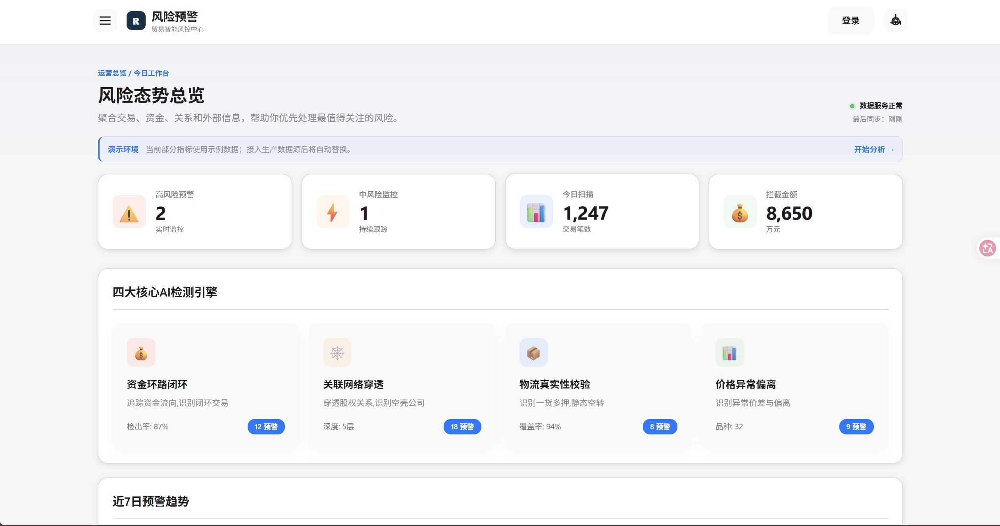
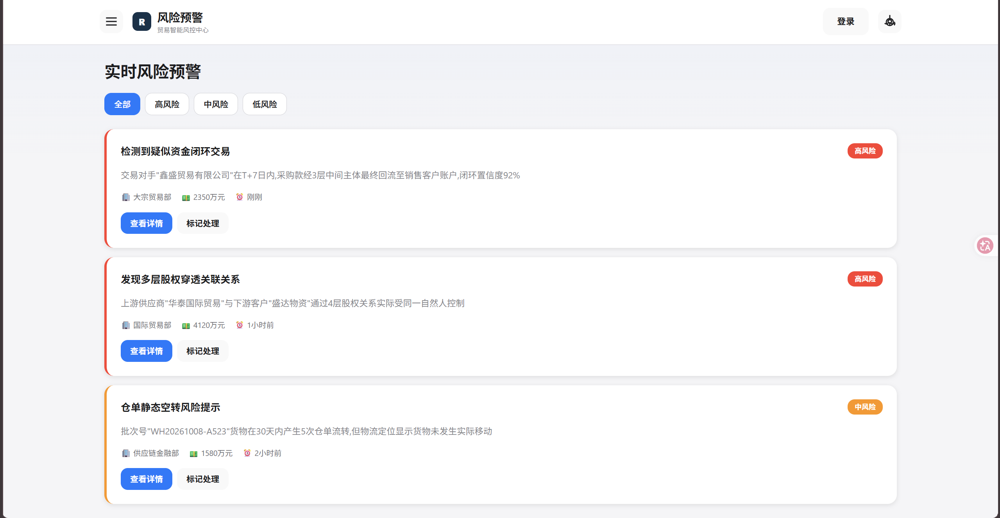
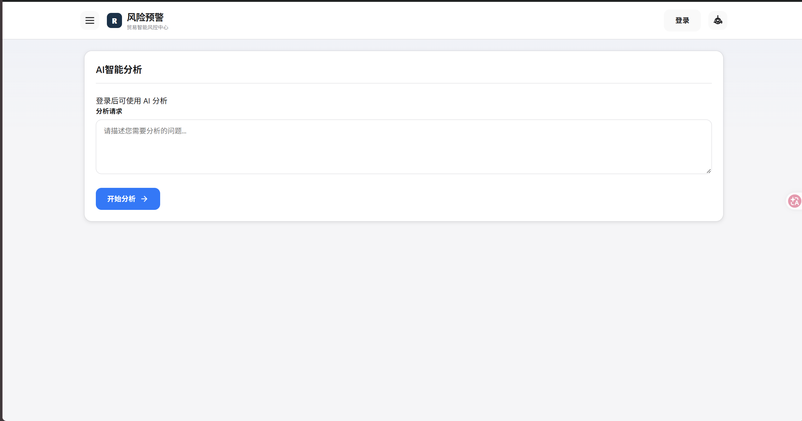
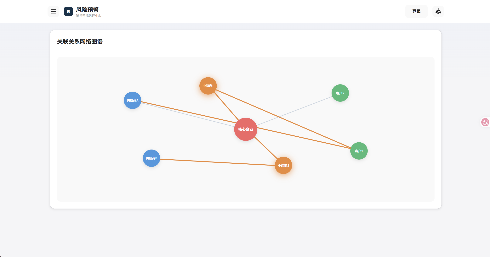
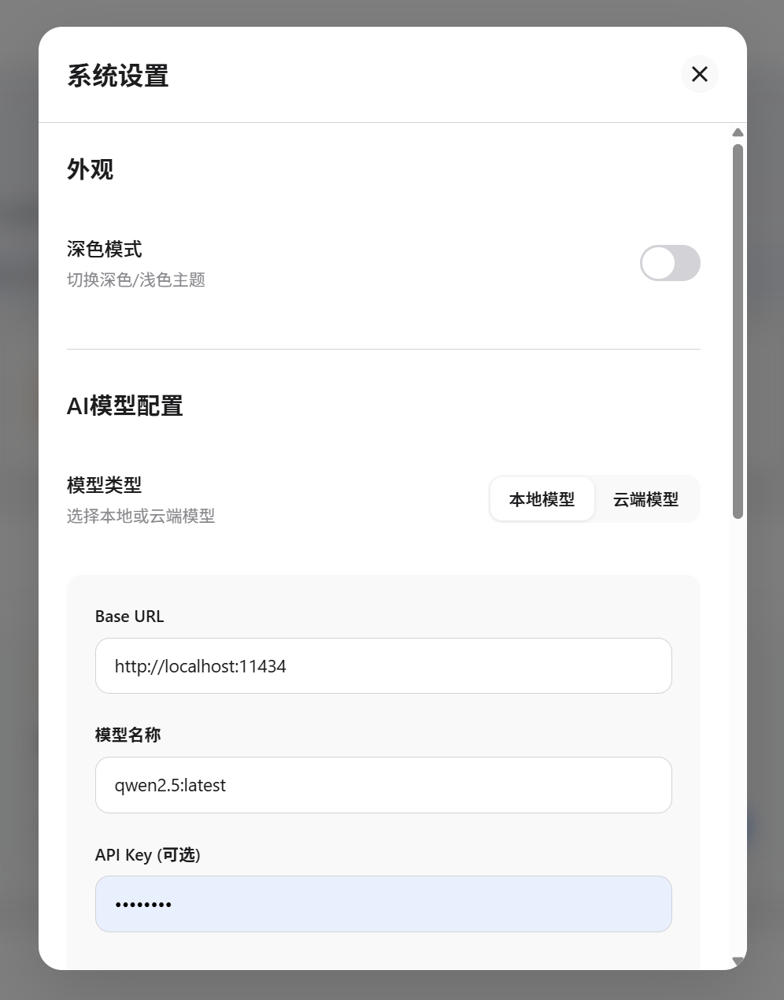

# 虚假贸易 AI 风险预警平台

面向贸易、供应链金融和企业合规场景的风险预警 Web 平台。系统围绕货物流、资金流、单据流和关系流提供统一的风险态势视图，并接入可配置的 AI 模型、UAPI 数据服务和雪球行情服务。

> 当前版本是可运行的 Web Demo/业务原型：预警样例、统计数据、系统配置和审计日志仍以内存或演示数据为主。接入真实生产数据前，请完成数据库、权限、密钥和合规审查。

## 功能概览

- 风险态势总览：高、中、低风险预警、扫描量、拦截金额和趋势图。
- 四流检测视图：资金环路、关联网络、物流真实性、价格偏离四类风险入口。
- 关系网络图谱：企业、供应商、客户和关联方节点及关系链路可视化。
- AI 分析：支持本地模型（Ollama、LM Studio 等）或 OpenAI 兼容云端模型，可配置 Base URL、模型名、温度、最大 Token 和思考强度。
- UAPI 数据服务：通过服务端代理调用 uapis.cn，包含热榜、IP 查询和风险检测等能力。
- 雪球数据服务：查询股票报价、综合财务指标和批量分析结果。
- 管理后台：查看系统统计、API 状态、运行配置和审计日志。
- 统一登录：本地管理员登录和 URLTime SSO，登录成功后返回原页面。
- 响应式界面：iOS 风格浅色/深色主题，适配桌面、平板和移动浏览器。

## 技术栈

- Node.js 18+、Express 4
- 原生 HTML、CSS、JavaScript，无前端构建步骤
- Axios、dotenv、Puppeteer（雪球数据服务）
- 服务端会话 Cookie：HttpOnly、SameSite，可配置 Secure

## 快速开始

### 1. 安装依赖

    npm install

### 2. 创建配置文件

Windows PowerShell：

    Copy-Item .env.example .env

macOS/Linux：

    cp .env.example .env

至少修改以下配置：

    PORT=3000
    SESSION_SECRET=请替换为足够长的随机字符串
    ADMIN_USERNAME=admin
    ADMIN_PASSWORD=请修改为强密码
    DEFAULT_MODEL_TYPE=local
    LOCAL_MODEL_BASE_URL=http://localhost:11434
    LOCAL_MODEL_NAME=qwen2.5:latest

.env 只在服务端读取，禁止提交到 Git。不要把 UAPI、云模型、SSO 或其他密钥写入前端文件。

### 3. 启动服务

    npm start

浏览器打开 http://localhost:3000。管理后台位于 http://localhost:3000/admin.html。

## 登录与会话

本地登录使用 .env 中的 ADMIN_USERNAME 和 ADMIN_PASSWORD。登录成功后，服务端通过 HttpOnly Cookie 建立会话，前端不会保存 JWT，也不会把令牌放进 URL。退出登录调用 /api/auth/logout 并使当前会话失效。

AI 分析接口要求已登录；未登录调用返回 401。管理接口要求管理员角色；权限不足返回 403。

### URLTime SSO 配置

在 URLTime 控制台创建 OAuth 客户端，然后填写：

    URLTIME_AUTH_BASE_URL=https://login.urltime.cn/api/v1
    URLTIME_SSO_CLIENT_ID=你的客户端 ID
    URLTIME_SSO_CLIENT_SECRET=你的客户端密钥
    URLTIME_SSO_REDIRECT_URI=http://localhost:3000/api/auth/callback

SSO 使用一次性 state Cookie 校验，登录成功后按安全的同源回跳地址返回。生产环境应将回调地址改为 HTTPS 域名，并设置 COOKIE_SECURE=true。

## API 端点

### 公共业务接口

| 方法 | 路径 | 说明 |
| --- | --- | --- |
| GET | /api/health | 健康检查 |
| GET | /api/statistics | 风险统计 |
| GET | /api/alerts | 预警列表，可按 level、status 筛选 |
| GET | /api/alerts/:id | 预警详情 |
| PUT | /api/alerts/:id/status | 更新预警状态 |
| GET | /api/network-graph | 关系网络图数据 |
| GET | /api/settings | 获取脱敏后的系统设置 |
| PUT | /api/settings | 更新系统设置 |

### 认证接口

| 方法 | 路径 | 说明 |
| --- | --- | --- |
| POST | /api/admin/login | 本地管理员登录，成功后写入 HttpOnly Cookie |
| GET | /api/auth/me | 获取当前会话用户 |
| POST | /api/auth/logout | 注销当前会话 |
| GET | /api/auth/sso-status | 查看 URLTime SSO 是否配置 |
| GET | /api/auth/sso-login | 获取 URLTime 授权地址 |
| GET | /api/auth/callback | URLTime OAuth 回调 |

### UAPI 接口

| 方法 | 路径 | 说明 |
| --- | --- | --- |
| GET | /api/uapi/platforms | 支持的热榜平台 |
| GET | /api/uapi/hotboard/:type | 当前热榜 |
| GET | /api/uapi/hotboard/:type/snapshot?time=... | 历史热榜快照 |
| GET | /api/uapi/hotboard/:type/search?keyword=...&time_start=...&time_end=...&limit=... | 历史热榜搜索 |
| POST | /api/uapi/hotboard/batch | 批量查询热榜 |
| GET | /api/uapi/myip | 当前 IP 查询 |
| GET | /api/uapi/ip/:ip | 指定 IP 查询 |
| POST | /api/uapi/detect-risk | 文本风险检测 |

UAPI Key 通过 UAPI_API_KEY 配置，由后端以 Authorization: Bearer 方式发送。未配置时仅能使用服务端允许的免费能力。

### 雪球接口

| 方法 | 路径 | 说明 |
| --- | --- | --- |
| GET | /api/xueqiu/quote/:scode | 股票报价，例如 SH600519 |
| GET | /api/xueqiu/comprehensive/:scode | 综合行情与财务分析 |
| POST | /api/xueqiu/batch-analysis | 批量分析，Body 为 { scodes: [SH600519] } |

雪球数据来自服务端抓取/接口封装，可能受网络、Cookie、目标站限流或页面变更影响；不要把它当作交易执行或投资建议依据。

## AI 模型配置

本地模型示例：

    DEFAULT_MODEL_TYPE=local
    LOCAL_MODEL_BASE_URL=http://localhost:11434
    LOCAL_MODEL_NAME=qwen2.5:latest
    LOCAL_MODEL_API_KEY=

云端模型示例：

    DEFAULT_MODEL_TYPE=cloud
    CLOUD_MODEL_BASE_URL=https://api.openai.com/v1
    CLOUD_MODEL_NAME=gpt-4
    CLOUD_MODEL_API_KEY=请填写服务端密钥
    DEFAULT_THINKING_EFFORT=medium
    DEFAULT_TEMPERATURE=0.7
    DEFAULT_MAX_TOKENS=2000

只要服务提供 OpenAI 兼容的 /chat/completions 接口，即可通过 Base URL 接入兼容模型服务。管理员后台会对 API Key 脱敏后再返回前端。

## 目录结构

    虚假贸易AI风险预警平台/
    ├── server/
    │   ├── index.js                  Express 服务、业务路由和启动入口
    │   ├── middleware/auth.js        会话 Cookie、本地登录和 URLTime SSO
    │   ├── services/uapiService.js   UAPI 服务层
    │   ├── services/uapiSDK.js       UAPI SDK 风格封装
    │   ├── services/xueqiuService.js 雪球服务层
    │   └── xueqiu/                   雪球请求模块
    ├── public/
    │   ├── index.html                风险平台首页
    │   ├── admin.html                管理后台登录与控制台
    │   ├── app.js                    首页交互和数据渲染
    │   ├── admin.js                  后台交互
    │   └── styles.css                iOS 风格主题和响应式样式
    ├── .env.example                  环境变量模板
    ├── ai.md                         项目需求与 AI 说明
    ├── UAPI_SDK_GUIDE.md             UAPI 接入说明
    └── package.json                  Node.js 依赖和脚本

## 验证与排障

    node --check server/index.js
    node --check server/middleware/auth.js
    node --check public/app.js
    node --check public/admin.js
    Invoke-WebRequest http://localhost:3000/api/health

常见问题：

- 登录后仍显示未登录：确认浏览器允许同源 Cookie；不要从 file:// 直接打开 HTML，必须通过 Node 服务访问。
- AI 返回 401：先登录，再调用分析；检查 /api/auth/me 是否返回当前用户。
- AI 连接失败：检查 Base URL 是否可访问，且服务确实提供 /chat/completions。
- UAPI 失败：检查 UAPI_API_KEY、网络连通性和接口限流；不要在浏览器端直连 UAPI。
- 雪球无数据：目标站可能需要 Cookie，或接口响应结构发生变化。
- SSO 回调失败：核对客户端密钥、回调地址、域名协议和系统时间。

## 生产部署清单

1. 使用 HTTPS，设置 NODE_ENV=production 和 COOKIE_SECURE=true。
2. 生成随机、长度足够的 SESSION_SECRET，修改管理员密码，删除示例密钥。
3. 配置真实 URLTime SSO 回调地址，限制允许的来源和回跳地址。
4. 将 server/.sessions.json 迁移到 SQLite、PostgreSQL 或 Redis，以支持多实例部署和会话审计。
5. 配置反向代理、CORS 白名单、请求限流和结构化日志。
6. 对 UAPI、AI、雪球返回内容做超时、重试、脱敏和错误监控。
7. 明确数据来源授权、个人信息处理范围和金融信息使用边界。

## 页面

## 联系我们

## 版本

当前文档对应项目 1.0.0 原型版本。维护团队：数字创新部。

